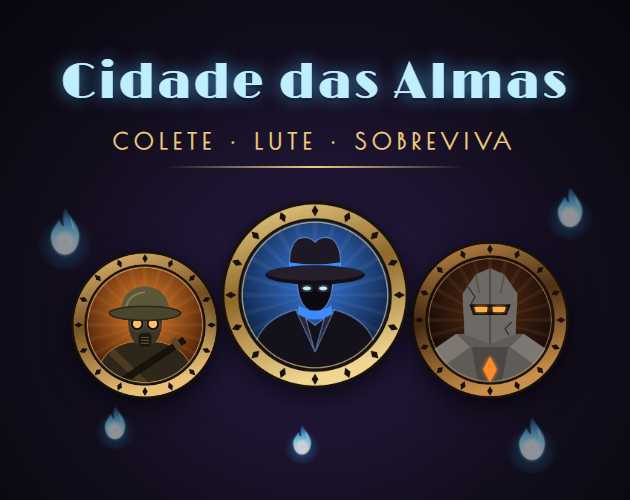
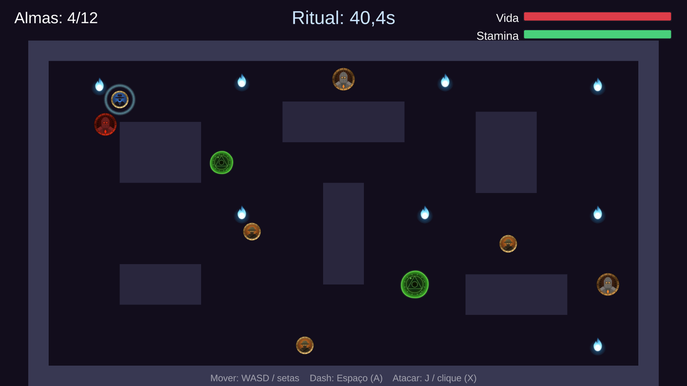

# Cidade das Almas

Jogo 2D top-down feito em Unity: colete as almas perdidas da cidade antes que o tempo do ritual acabe, enquanto foge de tropas, guardiões e poças de corrupção.

**[▶ Jogue no navegador pelo itch.io](https://felipecameloss.itch.io/cidade-das-almas)**

## Como jogar

- Colete as **12 almas** antes que o cronômetro do ritual zere. Cada alma dá **+3 segundos**.
- **Tropas** patrulham as ruas; **guardiões** perseguem quem chega perto (e atravessam paredes); **poças de corrupção** drenam vida.
- O **dash** deixa você invulnerável por um instante, mas gasta stamina.
- O **ataque** derruba tropas com um golpe e guardiões com dois.

| Ação | Teclado / mouse | Controle (Xbox) |
|---|---|---|
| Mover | WASD / setas | Analógico esquerdo |
| Dash | Espaço | A |
| Atacar | J / clique esquerdo | X |
| Jogar novamente | R | Start |
| Voltar ao menu | M | B |

## Abrindo o projeto

1. Instale o **Unity 6000.6.5f1** pelo Unity Hub.
2. Clone o repositório e, no Unity Hub, use **Add → Add project from disk**.
3. Abra a cena `Assets/Scenes/MenuPrincipal.unity` e aperte Play.

Na primeira abertura o Unity recria a pasta `Library`, o que leva alguns minutos.

## Estrutura

| Pasta | Conteúdo |
|---|---|
| `Assets/Scripts` | Código do jogo (jogador, inimigos, UI, menu) |
| `Assets/Editor/CidadeDasAlmasBuilder.cs` | Monta as cenas, sons e configurações. Menu **Cidade das Almas** no editor |
| `Assets/Scenes` | `MenuPrincipal` (primeira cena do build) e `CidadeDasAlmas` (a fase) |
| `Assets/Art`, `Assets/Audio` | Sprites e sons |
| `ArtSource/gerar_sprites.js` | Fonte dos sprites em SVG. Rode `node ArtSource/gerar_sprites.js` para regerar os PNGs |
| `itchio/` | Capa, screenshots e descrição da página do itch.io |

> **Atenção:** o menu **Cidade das Almas → Construir Cena** recria as duas cenas do zero e apaga qualquer edição manual feita nelas.

## Gerando os builds

- **Windows:** File → Build Profiles → Windows → Build.
- **Navegador (itch.io):** menu **Cidade das Almas → Build WebGL (itch.io)**. O resultado vai para `Builds/WebGL`. Compacte o *conteúdo* dessa pasta (com `index.html` na raiz do zip) e envie ao itch marcado como "played in the browser".

---

*Fan game inspirado na estética de Deadlock. Sem nenhuma afiliação com a Valve Corporation. Todos os sprites, sons e músicas são originais.*
